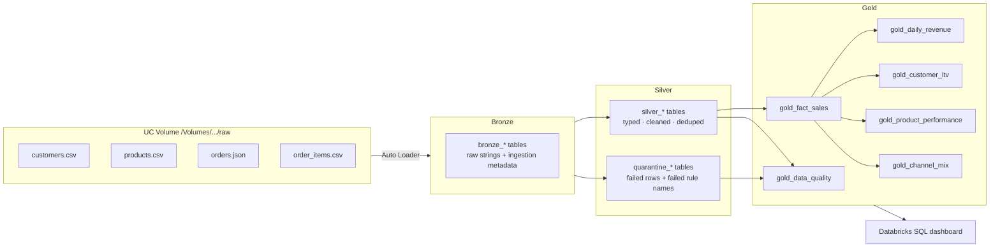

# Retail Lakehouse on Databricks

An end-to-end **medallion architecture** (Bronze → Silver → Gold) data pipeline for an
e-commerce business, built with **PySpark**, **Delta Lake**, **Auto Loader** and
**Unity Catalog**. It runs on Databricks Free Edition. The transformation logic is plain PySpark,
so it is unit-tested locally and in CI.



## Highlights

- **Incremental ingestion** with Auto Loader (`cloudFiles`, `availableNow` trigger) and checkpoints.
- **Explicit raw schemas**: everything lands as strings, so malformed values are never silently nulled.
- **Data-quality framework**: declarative rules per entity. Failing rows go to `quarantine_*`
  tables with the exact rules they broke, and the job fails if a pass rate drops below a threshold.
- **Idempotent upserts**: customers use Delta `MERGE` (SCD type 1, latest `updated_at` wins).
- **Messy-data handling**: mixed date and timestamp formats, duplicates, bad emails, invalid prices,
  negative quantities and orphaned foreign keys.
- **Performance**: the Gold fact table is partitioned by `order_date`, and Silver is `OPTIMIZE` + `ZORDER`ed.
- **Orchestration**: a 4-task Databricks Job defined as a Databricks Asset Bundle (`databricks.yml`).
- **Tested**: 15 PySpark unit tests plus an end-to-end smoke run in GitHub Actions.

## Project structure

```
├── databricks.yml               # Asset Bundle: job with bronze → silver → gold → DQ tasks
├── notebooks/
│   ├── 00_setup.py              # create schema + volume, generate raw data
│   ├── 01_bronze_ingest.py      # Auto Loader → bronze_*
│   ├── 02_silver_transform.py   # clean, validate, MERGE, quarantine
│   ├── 03_gold_aggregates.py    # fact table + KPI tables
│   └── 04_data_quality.py       # DQ report + threshold gate
├── src/retail_lakehouse/
│   ├── bronze.py  silver.py  gold.py  quality.py
│   ├── schemas.py config.py
│   ├── data_generator.py        # realistic, deliberately dirty sample data
│   └── pipeline.py              # run everything (Databricks or --local)
├── sql/dashboard_queries.sql    # KPI, trend, segment, and DQ queries for the dashboard
└── tests/                       # pytest + local SparkSession
```

## Data model (Gold)

| Table | Grain | Key columns |
|---|---|---|
| `gold_fact_sales` | order line | order, product, customer attributes, `line_total`, `is_revenue` |
| `gold_daily_revenue` | day | orders, units, revenue, AOV, 7-day moving average |
| `gold_customer_ltv` | customer | lifetime revenue, orders, recency, segment (Champion / Loyal / Developing / At Risk) |
| `gold_product_performance` | product | units, revenue, rank within category |
| `gold_channel_mix` | month × channel | revenue and share of monthly revenue |
| `gold_data_quality` | entity × run | total, valid, quarantined, pass rate |

Revenue counts only `COMPLETED` and `SHIPPED` orders. Cancelled, returned and pending orders stay in the
fact table for analysis but are excluded from KPIs.

## Data-quality rules

| Entity | Rules |
|---|---|
| customers | `customer_id_not_null`, `email_valid`, `signup_date_parsed` |
| products | `product_id_not_null`, `unit_price_positive`, `category_present` |
| orders | `order_id_not_null`, `customer_id_not_null`, `order_ts_parsed`, `status_known` |
| order_items | `order_item_id_not_null`, `quantity_positive`, `unit_price_non_negative`, `discount_in_range`, `order_exists`, `product_exists` |

Sample run on 6,000 orders and 11,383 order lines:

| Entity | Total | Valid | Quarantined | Pass rate |
|---|---:|---:|---:|---:|
| customers | 800 | 776 | 24 | 97.0% |
| products | 150 | 142 | 8 | 94.7% |
| orders | 6,000 | 5,933 | 67 | 98.9% |
| order_items | 11,383 | 10,622 | 761 | 93.3% |

Most quarantined order lines are *orphans*: their product or order was itself rejected, so they cannot be trusted.

## Run it on Databricks

1. Import this repo with **Workspace → Create → Git folder** and paste the repo URL.
2. Run `notebooks/00_setup.py`. This creates `workspace.retail` and the `raw` volume, and lands the sample data.
3. Run notebooks `01` → `04` in order, or deploy the job:
   ```bash
   databricks bundle deploy -t dev
   databricks bundle run retail_lakehouse_pipeline
   ```
4. Build a dashboard from `sql/dashboard_queries.sql`.

## Run it locally

Requires Python 3.11 and Java 17.

```bash
python3.11 -m venv .venv && source .venv/bin/activate
pip install -r requirements-dev.txt
pytest -q                                                         # unit tests
PYTHONPATH=src python -m retail_lakehouse.data_generator          # writes data/raw
PYTHONPATH=src python -m retail_lakehouse.pipeline --local        # writes Parquet to output/
```

## Tech stack

Databricks · Apache Spark (PySpark) · Delta Lake · Auto Loader · Unity Catalog · Databricks
Asset Bundles · Databricks SQL · pytest · GitHub Actions
